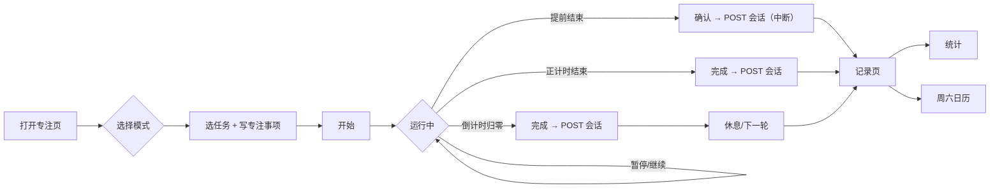
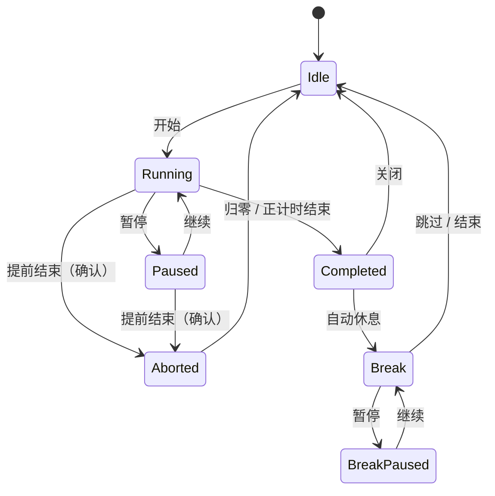

# 番茄专注 · 产品需求文档（PRD）

| 项目 | 内容 |
|---|---|
| 产品名称 | 番茄专注（暂定） |
| 版本 | v1.1（技术栈调整为全栈方案） |
| 文档状态 | 待评审 |
| 更新日期 | 2026-11-11 |
| 目标平台 | Web / PWA（桌面 + 手机浏览器） |
| 用户范围 | 单用户、自建服务、无多租户 |
| 配套文档 | [技术方案.md](技术方案.md)、[UI设计规范.md](UI设计规范.md) |

> **注意**：第一版（MVP）只实现 [MVP-v1-开发文档.md](MVP-v1-开发文档.md)。本文是 v2 需求池，当前不要按本文开发。

> v1.1 变更：由「纯前端 + IndexedDB」改为「Vue3 + Spring Boot + MySQL」，数据集中在自建服务，手机与电脑共享；UI 参考滴答清单的信息架构与视觉语言。计时逻辑仍在前端，服务端只负责持久化与统计。

---

## 1. 背景与目标

### 1.1 背景

使用者是备战考研的软件工程学生，需要一个每天会用的专注计时工具：打开就能计时，结束后能看到今天学了多久、花在哪个任务上、这一周的时间分布。市面 App 功能过重、数据不在自己手里，因此自建一套：前端 Vue3，后端 Spring Boot + MyBatis + MySQL，Docker 一键启动，数据存在自己的机器上。

项目同时承担两个目标：**支撑考研的时间管理**，以及**练习一套完整的 Java 全栈工程能力**（分层架构、动态 SQL、索引设计、幂等、容器化部署）。

### 1.2 产品目标

| 编号 | 目标 | 衡量方式 |
|---|---|---|
| G1 | 3 秒内开始一次专注 | 打开页面到点击「开始」≤ 2 次交互 |
| G2 | 计时准确、刷新不丢 | 60 分钟误差 ≤ 1 秒；刷新/关闭可恢复 |
| G3 | 每天愿意打开 | 连续使用 14 天，日均 ≥ 2 次专注 |
| G4 | 能回答“时间花哪了” | 任意一天 3 次点击内看到总时长与任务分布 |
| G5 | 一键复现 | 新机器 `docker compose up -d` 后 3 分钟内可用 |

### 1.3 非目标

- 多用户、注册、权限体系、社交；
- 云托管、多租户 SaaS；
- Android / iOS 原生 App、浏览器插件；
- 任务清单、标签、优先级、子任务、重复任务；
- 推送通知、系统日历同步；
- AI 分析、白噪音、成就体系；
- 离线写入与冲突合并（断网时仅保证计时不中断，结束后重试提交）；
- 补录历史记录。

---

## 2. 用户与场景

### 2.1 用户

单一用户，备考学生。设备：Windows 笔记本（主）+ Android 手机（辅）。使用环境：家里/图书馆同一 Wi-Fi，手机通过局域网 IP 访问笔记本上的服务；后期可把 Docker 部署到云服务器，实现随时随地访问。

### 2.2 核心场景

**A 开始一次学习**：早上打开应用，选「倒计时 25 分钟」，选任务「数学-高数第三章」，填写「极限章节习题 1-20」，开始。中途接电话暂停 3 分钟，回来继续。归零后提示音，自动进入 5 分钟休息。

**B 随手记录**：下午不确定学多久，选「正计时」，选任务「英语-阅读」，40 分钟后手动结束。

**C 晚上复盘**：统计页看到今天 3 小时 20 分、5 个番茄、中断 1 次；饼图数学 2 小时、英语 1 小时 20 分；切到日历周视图，看到周三晚上空着。

**D 手机接着看**：在手机上打开同一地址，数据与电脑一致；第二天在图书馆用手机计时。

### 2.3 使用节奏

- 学习前：选模式 → 选任务 → 写专注事项 → 开始；
- 学习中：暂停/继续/提前结束；
- 结束后：看本次时长，进入休息；
- 每晚：看统计；
- 每周日：看日历周视图 + 周统计；
- 每周：在设置页导出一次备份。

---

## 3. 范围与优先级

| 模块 | 功能 | 优先级 |
|---|---|---|
| 计时器 | 正计时、倒计时、开始/暂停/继续/结束、中断、刷新恢复、多标签互斥 | P0 |
| 计时器 | 番茄循环（专注 + 短休 + 每 4 个长休）、自动开始下一段 | P0 |
| 计时器 | 关联任务、专注事项、结束提示音、页面标题显示剩余时间 | P0 |
| 任务 | 极简任务：新建、完成、编辑、删除、截止日 | P0 |
| 记录 | 列表、详情、编辑备注、删除、筛选、分页 | P0 |
| 统计 | 今日/本周/本月概览、趋势、任务分布、中断占比、连续天数 | P0 |
| 统计 | 年度视图、时段分布 | P1 |
| 日历 | 周视图时间块、切换周、任务筛选、点击详情 | P0 |
| 日历 | 月视图、拖拽调整 | P1 / P2 |
| 设置 | 时长、自动开始、声音、主题、每日目标 | P0 |
| 数据 | 服务端导出 JSON、备份说明 | P0 |
| 数据 | 导入、多端冲突处理 | P2 |
| 体验 | 响应式、深色模式、PWA 安装 | P0 |
| 体验 | 断网续传（本地暂存 + 幂等重试）、桌面通知、快捷键 | P1 |

---

## 4. 名词与核心概念

| 名词 | 定义 |
|---|---|
| 专注会话（Session） | 一次从开始到结束的计时记录，统计最小单位，存 MySQL |
| 正计时 | 从 0 向上累计，无目标，用户手动结束 |
| 倒计时 | 从设定时长递减，归零即完成；提前结束记为中断 |
| 番茄 | 一次**完成**的倒计时专注；正计时不计入 |
| 中断 | 倒计时未归零就结束；时长计入总时长，单独标记 |
| 休息 | 番茄之间的短休/长休；不写库、不统计 |
| 归属日 | 会话归属日期，取开始时间所在日期，跨天不拆分 |
| 任务 | 极简待办：标题、完成状态、截止日 |
| 专注事项 | 会话的文字说明，回答“这次在专注什么” |
| 幂等键 | 客户端为每次会话生成的 `clientId`（UUID），重复提交只落一条 |

---

## 5. 整体设计

### 5.1 系统架构

```
┌──────────────┐     HTTP/JSON      ┌──────────────────┐     JDBC      ┌──────────┐
│  Vue3 SPA    │ ─────────────────> │  Spring Boot 2.7 │ ────────────> │ MySQL 8  │
│  Vite / Pinia│ <───────────────── │  Controller      │ <──────────── │  InnoDB  │
│  Element Plus│                    │  Service         │               └──────────┘
│  ECharts     │                    │  Mapper(MyBatis) │
└──────────────┘                    └──────────────────┘
       │                                     ▲
       └──────── Nginx 静态托管 + /api 反向代理 ┘
```

- 前端：单页应用，Nginx 托管静态资源，`/api` 反向代理到后端；
- 后端：无状态 REST 服务，Controller–Service–Mapper 三层；
- 数据库：MySQL 8，单库 `focus_app`；
- 部署：Docker Compose 编排 `web` / `server` / `mysql` 三个容器，一条命令启动；
- 计时器运行在浏览器，服务端只接收最终结果，避免长连接与心跳。

### 5.2 页面地图

```
/                     重定向到 /focus
/focus                专注
/tasks                任务
/records              专注记录
/calendar             日历（周视图）
/stats                统计
/settings             设置
```

**导航：**

- 桌面端（≥1024px）：左侧 240px 侧边栏，含 Logo、快速添加、智能列表（专注/今天/最近 7 天）、功能入口（任务/记录/日历/统计）、底部设置与导出；
- 移动端（<1024px）：底部 Tab 5 个：专注、任务、日历、统计、我的；记录页从统计页与「我的」进入；
- 计时进行中，「专注」入口显示呼吸圆点。

### 5.3 主流程



### 5.4 计时器状态机



---

## 6. 功能需求

### 6.1 计时器（P0）

#### 6.1.1 模式与时长

- 分段控件「正计时 / 倒计时」，默认倒计时 25 分钟。
- 倒计时可在开始前用「+5 / −5」或输入调整，范围 1–180 分钟；记住上次使用的时长（存服务端设置）。
- 正计时从 `00:00:00` 向上累计。

#### 6.1.2 开始前

1. **关联任务**：下拉选择未完成任务，支持搜索；可「+ 新建任务」并选中；也可不关联。
2. **专注事项**：输入框，占位「这次要专注什么？例如：高数第三章习题 1-20」，最多 200 字。
3. 点击「开始」进入运行态。

#### 6.1.3 运行中

- 主视觉：环形进度 + 超大等宽数字 `HH:MM:SS`（`tabular-nums`）。
- 辅助：任务名、专注事项、本轮序号（第 N 个番茄）。
- 操作：暂停、结束（倒计时显示「结束并记录」）。
- 浏览器标题同步为 `25:00 · 专注中`。
- 运行中不可切换模式；专注事项可改并自动保存（本地）。

#### 6.1.4 暂停与继续

- 暂停后数字停止、环形变灰，显示「已暂停」与本次累计暂停时长。
- 继续后从暂停处恢复；暂停时长累计进 `pausedSec`，不计入专注时长。
- 暂停超过 30 分钟提示结束；超过 4 小时自动结束（倒计时记中断，正计时记完成）。

#### 6.1.5 结束与中断

| 模式 | 动作 | 状态 | 时长 |
|---|---|---|---|
| 倒计时 | 归零 | 完成 | 计划时长（精确到秒） |
| 倒计时 | 提前结束并确认 | 中断 | 实际经过时长（扣除暂停） |
| 正计时 | 手动结束 | 完成 | 实际经过时长（扣除暂停） |

- 提前结束二次确认：「本次专注还未完成，结束后会记为中断，时长仍会计入统计。」
- 结束后立即 `POST /api/sessions` 落库，不依赖「保存」按钮；成功后弹出结算卡片（时长、任务、事项、状态），提供「写备注」「开始休息 / 再来一个 / 完成」。
- 提交失败：进入本地待同步队列，顶部显示「待同步」，联网后自动重试（`clientId` 保证幂等）。

#### 6.1.6 番茄循环

- 默认 25 分钟专注 + 5 分钟短休；每完成 4 个番茄 → 15 分钟长休。
- 归零后：若「自动开始休息」开启，直接进入休息；否则显示结算卡片。
- 休息结束提示音；若「自动开始下一个番茄」开启，直接进入下一轮（沿用上一个任务与事项），否则回到准备态。
- 休息界面主色变绿，文案「休息一下」，显示下一个番茄时间；可「跳过」。
- **休息不写库、不参与统计、不产生会话。**

#### 6.1.7 刷新、关闭与恢复

- 运行态持久化到 `localStorage`（`focus_active_timer_v1`），只存开始时间戳、暂停累计、任务与事项，不每秒写库。
- 刷新/重开：
  - 倒计时已到期：自动补记完成，`endedAt = startedAt + plannedSec + pausedTotal`，提示「上次专注已结束，已自动记录」；
  - 正计时仍在进行：横幅「检测到未结束的专注（已进行 42 分钟）」，提供「继续 / 结束并保存 / 丢弃」；
  - 暂停中：恢复暂停态。
- 关闭浏览器等同刷新，下次按上述规则处理。

#### 6.1.8 多标签互斥

- 同一浏览器只允许一个活跃计时器；`localStorage` 锁 + 5 秒心跳。
- 第二个标签页检测到 15 秒内有效锁：显示只读横幅「另一个标签页正在计时」，禁用开始，提供「接管」。
- 接管后原标签页下次心跳失败降级为只读。

#### 6.1.9 声音与通知

- 结束提示音用 Web Audio API 合成两声短音，可关闭。
- 页面在后台且已授权 Notification 时，发送「专注结束」通知（best effort）。
- 最后 10 秒不倒数提示。

#### 6.1.10 快捷键（P1）

| 键 | 行为 |
|---|---|
| `Space` | 开始/暂停/继续（输入框聚焦时失效） |
| `Esc` | 结束并确认 |
| `1` / `2` | 切换正计时/倒计时（仅空闲） |

### 6.2 任务（P0）

- 字段：标题（1–100 字）、完成状态、截止日（日期粒度）。
- 新建：任务页顶部输入框，回车即建；可展开选截止日。
- 分组：「今天」「即将到期」「更晚」「无截止日」「已完成」；组内按截止日升序、同日期按创建时间倒序。
- 行内容：复选框、标题、截止日徽标（今天蓝、逾期红「逾期 N 天」）、累计专注时长。
- 操作：勾选完成/取消、行内编辑、删除（软删除，5 秒撤销）。
- 删除任务不影响历史会话：会话保留 `taskTitle` 快照，展示为「已删除任务」。
- 计时页任务选择器只列未完成任务。

### 6.3 专注记录（P0）

- 按日期倒序分组，组头「11月11日 周二 · 3h20m」。
- 单条：时间段（`14:05 – 14:30`）、时长、任务/事项、模式图标、状态徽标（完成/中断）。
- 筛选：状态（全部/完成/中断）、时间范围（今天/本周/本月/全部）、任务。
- 分页：默认每页 20 条，滚动加载或「加载更多」。
- 详情抽屉：完整起止、时长、暂停时长、任务、事项、状态；可编辑备注、删除。
- 删除为软删除，统计同步排除；Toast 撤销 5 秒。
- 空态：「还没有专注记录，去开始第一个番茄吧」。

### 6.4 统计（P0）

#### 6.4.1 范围

今日 / 本周 / 本月 / 今年（P1）。左右箭头切换上一周期，点击标题回到当前。

#### 6.4.2 指标

| 指标 | 定义 |
|---|---|
| 总专注时长 | 周期内未删除会话 `duration_sec` 之和；默认含中断，可开关排除 |
| 番茄数 | `mode=countdown && status=completed` |
| 中断次数/中断率 | 中断数；中断率 = 中断数 ÷（中断 + 完成倒计时），正计时不参与分母 |
| 日均时长 | 总时长 ÷ 周期天数（今日不显示） |
| 连续天数 | 从今天向前，每天至少 1 条 ≥ 60 秒的会话 |
| 任务分布 | 按 `task_id` 聚合，Top 5 + 其他；无任务归「未关联」 |
| 时段分布（P1） | 按开始小时归入 0–23 点 |

#### 6.4.3 视图

- **今日**：4 个指标卡 + 任务分布环形图 + 当日时间线（0–24 点色块）。
- **本周**：7 天柱状图（今天高亮）+ 指标卡 + 任务排行 Top5（时长、占比）+ 中断占比。
- **本月**：每日柱状图 + 指标卡 + 任务排行。
- **今年（P1）**：12 个月柱状图 + 年度汇总。

#### 6.4.4 图表规范

- ECharts，动画 ≤ 300ms 或关闭；
- 任务分布固定 6 色盘，按任务 id 稳定分配；
- 空数据展示占位文案，不画空坐标系；
- 数值格式：≥1 小时「X 小时 Y 分」，<1 小时「Y 分钟」，<1 分钟「< 1 分钟」。

### 6.5 日历（P0，周视图）

#### 6.5.1 布局

- 桌面：7 列（周一–周日）× 24 小时时间轴，左侧刻度，默认滚到 08:00，当前时间红线。
- 移动（<768px）：单日视图，顶部 7 个日期切换（有记录的日期带圆点）。
- 工具栏：`‹ 本周 ›`、`今天`、周范围（`11月10日 – 11月16日`）、任务筛选。

#### 6.5.2 时间块

- 会话绝对定位：`top` 按开始时间偏移，`height` 按时长，最小 20px。
- 颜色按任务稳定分配；无任务用中性色；中断加斜纹/虚线边框 + 「中断」标签。
- 块内显示时长；≥30 分钟再显示任务名/事项（超出省略）。
- 重叠：同列横向分栏，最多 3 栏，超出合并「+N」。
- 点击色块：气泡显示起止、时长、任务、事项、状态，操作「查看详情」「删除」。
- 点击空白：不新建，提示「去专注页开始计时」。

#### 6.5.3 交互

- 上一周/下一周/本周；键盘 `←` `→`。
- 任务筛选后只显示该任务，头部总时长同步。
- 空态：「本周还没有专注记录」。

### 6.6 设置（P0）

| 分组 | 项 | 默认 |
|---|---|---|
| 计时 | 专注时长 | 25 分钟 |
| 计时 | 短休息 | 5 分钟 |
| 计时 | 长休息 | 15 分钟 |
| 计时 | 每几个番茄长休息 | 4 |
| 计时 | 自动开始休息 | 开 |
| 计时 | 自动开始下一个番茄 | 关 |
| 计时 | 结束提示音 | 开 |
| 目标 | 每日专注目标 | 120 分钟 |
| 外观 | 主题 | 跟随系统 |
| 数据 | 导出 JSON、存储说明 | — |
| 关于 | 版本、服务地址、数据表说明 | — |

- 保存调 `PUT /api/settings`，成功 Toast「已保存」；失败回滚并提示。
- 正在进行的计时不受影响，下一轮生效。

### 6.7 数据管理（P0）

- **导出**：`GET /api/export` 返回 JSON 文件 `focus-backup-YYYYMMDD-HHmm.json`，含 `schemaVersion`、`exportedAt`、`tasks`、`sessions`、`settings`；导出前展示记录条数。
- **导入**：P2，v1 不做；文档给出后续扩展点。
- **备份提醒**：设置页显示「上次导出时间」，超过 7 天提示。
- 数据在 MySQL，Docker volume 持久化；README 说明 `mysqldump` 备份命令。

### 6.8 全局体验（P0）

- 响应式：≥1280 三栏；1024–1279 侧边栏收起为图标；768–1023 单栏；<768 底部 Tab。
- 深色模式：跟随系统 + 手动切换，全页面适配。
- PWA：manifest + 图标 + 离线壳缓存；断网可打开页面与计时，但数据提交需联网（进入待同步队列）。
- 首屏：路由懒加载，首屏 JS < 250KB（gzip）。
- 无障碍：按钮 `aria-label`；计时数字 `aria-live="off"`，仅在开始/暂停/结束时播报；键盘可完成主流程。
- 错误：全局错误提示；接口失败不阻塞计时。

---

## 7. 页面说明

页面布局、组件、间距、配色与线框见 [UI设计规范.md](UI设计规范.md)，本节只定义信息与行为。

| 页面 | 核心内容 | 关键状态 |
|---|---|---|
| 专注 `/focus` | 模式切换、任务选择、事项输入、环形计时、控制按钮、今日进度 | 空闲/运行/暂停/休息/只读/恢复提示 |
| 任务 `/tasks` | 快速添加、分组列表、截止日、累计时长 | 空/加载/逾期/已完成折叠 |
| 记录 `/records` | 筛选、按日分组、分页、详情抽屉 | 空/加载/筛选无结果 |
| 日历 `/calendar` | 周工具栏、时间网格、色块、图例 | 空周/筛选/移动单日 |
| 统计 `/stats` | 周期切换、指标卡、图表、排行 | 空周期/加载/切换 |
| 设置 `/settings` | 分组表单、导出、关于 | 保存中/失败回滚 |

---

## 8. 数据与接口摘要

详细 DDL、接口契约见 [技术方案.md](技术方案.md)。

### 8.1 表

| 表 | 说明 |
|---|---|
| `task` | 极简任务，软删除 |
| `focus_session` | 专注会话，`client_id` 唯一索引保证幂等 |
| `app_setting` | 单行设置 |

### 8.2 接口分组（22 个）

| 分组 | 接口 |
|---|---|
| 任务 | `GET /api/tasks`、`GET /api/tasks/options`、`GET /api/tasks/{id}`、`POST /api/tasks`、`PUT /api/tasks/{id}`、`PATCH /api/tasks/{id}/done`、`DELETE /api/tasks/{id}` |
| 会话 | `POST /api/sessions`、`GET /api/sessions`、`GET /api/sessions/{id}`、`PUT /api/sessions/{id}`、`DELETE /api/sessions/{id}`、`POST /api/sessions/sync`（批量补交） |
| 统计 | `GET /api/stats/summary`、`GET /api/stats/daily`、`GET /api/stats/tasks`、`GET /api/stats/streak`、`GET /api/stats/hourly`（P1） |
| 设置 | `GET /api/settings`、`PUT /api/settings` |
| 数据 | `GET /api/export` |
| 健康 | `GET /api/health` |

### 8.3 响应结构

```json
{ "code": 0, "message": "ok", "data": {} }
```

分页：

```json
{ "code": 0, "message": "ok", "data": { "total": 128, "list": [], "pageNum": 1, "pageSize": 20 } }
```

---

## 9. 业务规则

| 编号 | 规则 |
|---|---|
| BR-01 | 专注时长 = 结束 − 开始 − 累计暂停，向下取整到秒，最小 0 |
| BR-02 | 倒计时归零即完成，`duration_sec` 恒等于计划秒数，不受 tick 误差影响 |
| BR-03 | 倒计时提前结束二次确认，状态 `aborted`，时长按实际计算 |
| BR-04 | 正计时手动结束视为完成，不产生中断 |
| BR-05 | 中断默认计入统计，统计页提供「包含中断」开关，默认开 |
| BR-06 | 番茄数只统计「倒计时 + 完成」 |
| BR-07 | 休息不写库、不统计 |
| BR-08 | 归属日取开始时间所在日期，跨天不拆分 |
| BR-09 | 暂停 > 30 分钟提示；> 4 小时自动结束（倒计时中断、正计时完成） |
| BR-10 | 正计时 > 4 小时弹窗确认；> 12 小时强制结束并标记异常 |
| BR-11 | 同一浏览器只允许一个计时器，多标签 15 秒心跳锁 |
| BR-12 | 刷新/关闭按 6.1.7 恢复；倒计时已到期自动补记 |
| BR-13 | 删除任务不影响历史会话，保留 `task_title` 快照 |
| BR-14 | 删除会话为软删除，统计/日历/记录同步排除，5 秒可撤销 |
| BR-15 | 连续天数：当天至少 1 条 ≥ 60 秒的会话 |
| BR-16 | 中断率分母只含倒计时（完成 + 中断） |
| BR-17 | 每次会话由客户端生成 `clientId`，服务端唯一索引，重复提交返回已存在记录（200，不报错） |
| BR-18 | 服务端校验 `duration_sec` 与起止时间、暂停时长的一致性，偏差 > 5 秒拒绝 |
| BR-19 | 时长上限 12 小时；单条记录时长 < 1 秒不落库 |
| BR-20 | 设置修改即时保存，下一轮计时生效 |

---

## 10. 非功能需求

| 类别 | 要求 |
|---|---|
| 计时精度 | 60 分钟误差 ≤ 1 秒；以时间戳计算，不靠 `setInterval` 累加 |
| 接口性能 | 单用户场景，95% 接口 < 200ms；统计接口 1 万条会话 < 500ms |
| 页面性能 | 首屏 < 1.5s（局域网）；列表 1000 条不卡顿 |
| 并发 | 单用户，无需高并发；接口幂等可防重复提交 |
| 可用性 | 服务不可用时前端可继续计时并暂存，恢复后补交 |
| 安全 | 不暴露公网；无鉴权，README 明确警告；数据库账号最小权限 |
| 兼容 | Chrome/Edge 109+、Safari 16+、Android Chrome 109+ |
| 备份 | Docker volume + `mysqldump` 脚本；导出 JSON |
| 可维护 | 后端三层分层，前端 Repository/Store 分层，接口统一封装 |

---

## 11. 验收标准

### 11.1 计时

- [ ] 正计时从 00:00:00 开始递增，暂停停止、继续接续。
- [ ] 倒计时 25:00 归零后自动完成，落库时长为 1500 秒。
- [ ] 暂停 3 分钟后结束，记录暂停时长为 3 分钟，专注时长不含这 3 分钟。
- [ ] 倒计时进行到 10 分钟结束，确认后状态为中断，时长 10 分钟。
- [ ] 正计时 40 分钟手动结束，状态为完成，时长 40 分钟。
- [ ] 计时中刷新，恢复运行态且剩余时间正确。
- [ ] 倒计时结束后关页，10 分钟后打开，自动补记一条，刷新不重复。
- [ ] 两个标签页，第二个只读，可接管。
- [ ] 完成 4 个番茄进入长休息；休息不产生记录。
- [ ] 断网时结束计时显示「待同步」，联网后自动补交且只落一条。

### 11.2 任务

- [ ] 新建后出现在正确分组。
- [ ] 完成后移入「已完成」，计时选择器不再显示。
- [ ] 删除任务后历史记录仍显示原任务名。
- [ ] 逾期显示红色「逾期 N 天」。

### 11.3 记录与统计

- [ ] 记录按日期倒序，组头总时长等于组内之和。
- [ ] 状态筛选只显示对应记录；分页可加载更多。
- [ ] 今日总时长等于当日未删除会话之和。
- [ ] 关闭「包含中断」后总时长减少对应值。
- [ ] 中断率计算正确，正计时不影响分母。
- [ ] 任务分布 Top5 时长之和 ≤ 总时长。
- [ ] 连续天数在跨天、无记录时正确归零。

### 11.4 日历

- [ ] 周视图 7 列、24 小时，色块位置与起止时间一致。
- [ ] 中断块有斜纹标识。
- [ ] 重叠会话分栏不遮挡。
- [ ] 切换周数据正确，回到本周生效。
- [ ] 移动端单日视图可切换 7 天。

### 11.5 数据与部署

- [ ] `docker compose up -d` 后访问 `http://localhost:8080` 可用。
- [ ] 重启容器后数据仍在（volume）。
- [ ] 导出 JSON 含 tasks/sessions/settings。
- [ ] 同一 `clientId` 重复 POST 只产生一条记录。
- [ ] 非法参数返回统一错误结构，不抛 500 堆栈。

### 11.6 体验

- [ ] 375px 无横向滚动，底部 Tab 可用。
- [ ] 深色模式对比度足够。
- [ ] PWA 可安装，断网可打开并计时。

---

## 12. 里程碑

| 里程碑 | 内容 | 预计 | 验收 |
|---|---|---|---|
| M1 环境 | Docker Compose + Spring Boot 骨架 + Vue 骨架 + 建表 + health | 3 天 | 三个容器起来，前端能调通 health |
| M2 任务 | task 表/接口/页面 | 3 天 | 11.2 全过 |
| M3 会话 | session 表/接口（幂等）/记录页 | 3 天 | 11.3 前两条 |
| M4 计时器 | 状态机、正/倒计时、暂停、休息、恢复、待同步 | 4 天 | 11.1 全过 |
| M5 统计 | 聚合 SQL + 统计页图表 | 3 天 | 11.3 全过 |
| M6 日历 | 周视图、色块、重叠、筛选 | 3 天 | 11.4 全过 |
| M7 设置与导出 | 设置表单、导出、备份提示 | 2 天 | 11.5 后三条 |
| M8 UI 打磨 | 滴答风格还原、响应式、深色、动效 | 3 天 | 11.6 全过 |
| M9 部署 | 一键脚本、README、演示数据 | 2 天 | 新机器可复现 |

约 26 个工作日（每天 4–6 小时）。

---

## 13. 默认假设

| 项 | 默认 |
|---|---|
| 登录/鉴权 | 不做，仅本机/局域网使用 |
| 时区 | 单时区 Asia/Shanghai，时间存本地时间 |
| 周起始 | 周一 |
| 正计时结束 | 完成 |
| 年度统计 | P1 |
| 移动端日历 | 单日 + 7 天切换 |
| 补录 | 不做 |
| 导入 | P2 |
| 提醒 | 仅页面内与浏览器通知，不做服务端推送 |

---

## 14. 附录

### 14.1 关键文案

| 场景 | 文案 |
|---|---|
| 开始 | 开始专注 |
| 提前结束确认 | 本次专注还未完成，结束后会记为中断，时长仍会计入统计。 |
| 恢复 | 检测到未结束的专注，是否继续？ |
| 自动补记 | 上次专注已结束，已自动记录。 |
| 记录空态 | 还没有专注记录，去开始第一个番茄吧。 |
| 日历空态 | 本周还没有专注记录。 |
| 统计空态 | 这个周期还没有数据，先专注一次吧。 |
| 删除任务 | 任务已删除，历史专注记录会保留。 |
| 待同步 | 网络异常，记录已暂存，恢复后自动提交。 |
| 服务不可用 | 无法连接服务，请确认后端已启动。 |

### 14.2 设计参考

视觉与布局参考滴答清单的成熟做法：左侧清单式导航、任务行 + 右侧详情、专注页大环形计时、日历时间块、克制的蓝灰配色。具体规范见 [UI设计规范.md](UI设计规范.md)，不复制其品牌元素与图标。
